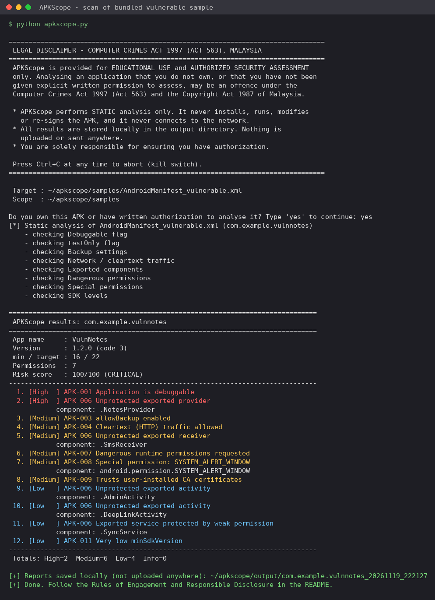
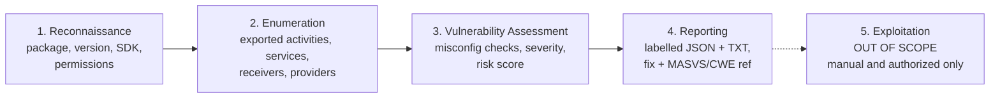
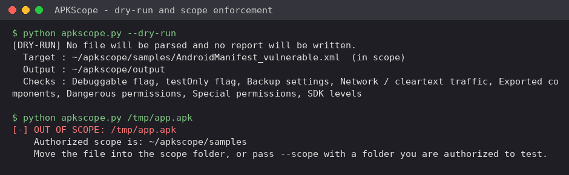
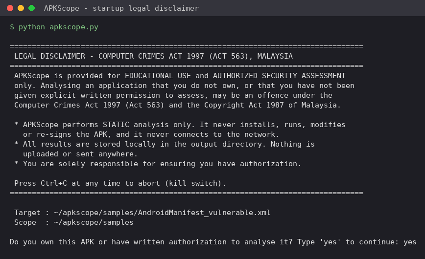

# APKScope: Android Manifest Security Analyzer

   

APKScope is a **static** security auditor for Android applications. It reads the
`AndroidManifest.xml` inside an APK and reports insecure configuration, exposed
components and risky permissions, with a severity level, a fix recommendation and
an OWASP MASVS / CWE reference for each finding. It **never installs, runs or
modifies** the app and never connects to the network.

> Group project for **IKB31603 Ethical Hacking**, UniKL MIIT, October 2026 (Group 4)



---

## Table of Contents
1. [Attack Category](#attack-category)
2. [Features](#features)
3. [Attack Lifecycle Mapping](#attack-lifecycle-mapping)
4. [Installation](#installation)
5. [Usage Examples](#usage-examples)
6. [Security Checks](#security-checks)
7. [Output](#output)
8. [Ethical Considerations](#ethical-considerations)
9. [Rules of Engagement (RoE)](#rules-of-engagement-roe)
10. [Responsible Disclosure](#responsible-disclosure)
11. [Legal Disclaimer](#legal-disclaimer)
12. [Limitations](#limitations)
13. [Project Structure](#project-structure)
14. [Team](#team)
15. [License](#license)

---

## Attack Category
**Mobile Application Attack**: attack-surface discovery and misconfiguration
assessment of Android applications, the first step before deeper mobile pentesting
(exported component abuse, backup extraction, MITM on cleartext traffic, overlay or
tapjacking).

## Features
- 8 check groups covering debuggable/testOnly builds, backup, cleartext traffic,
  network security config, exported components, dangerous and special permissions,
  and SDK levels
- Applies Android's **real default rules**: it detects *implicitly* exported
  components (intent-filter without `android:exported`), backup defaults, cleartext
  defaults for `targetSdk < 28`, and user-CA trust for `targetSdk < 24`
- Skips the launcher activity (it is meant to be exported) to reduce false positives
- Checks whether a permission-protected component uses a **weak custom permission**
  (`protectionLevel` normal or dangerous)
- **Risk score 0-100** with a rating (LOW / MEDIUM / HIGH / CRITICAL)
- Works on an `.apk` (through androguard) or on a decoded `AndroidManifest.xml`
  (for example from `apktool d`)
- Ethical guardrails: scope enforcement, Computer Crimes Act disclaimer, safe default
  target, `--dry-run`, two-stage kill switch, and local-only labelled output
- Unit tests that use a vulnerable sample and a hardened sample

## Attack Lifecycle Mapping



| Lifecycle stage | What APKScope does | Code |
|---|---|---|
| Reconnaissance | Extracts package name, app name, version, min/target SDK and all requested permissions | `loader.py` |
| Scanning / Enumeration | Lists every activity, alias, service, receiver and provider and works out which ones other apps can reach | `checks.py`: `effective_exported()` |
| Vulnerability Assessment | Flags insecure settings, gives a severity to each one and calculates a weighted risk score | `checks.py`: `CHECKS`, `risk_score()` |
| Reporting | Writes timestamped JSON and TXT reports with recommendations and references | `report.py` |
| Exploitation | **Not performed.** The findings tell an authorized tester where manual testing could follow (for example with `adb` or Drozer) | - |

## Installation

Requires **Python 3.9 or newer**.

**Windows (Command Prompt / PowerShell)**
```bat
git clone https://github.com/thaqifaziim89/apkscope.git
cd apkscope
python -m venv venv
venv\Scripts\activate
pip install -r requirements.txt
```

**Linux / Kali / macOS**
```bash
git clone https://github.com/thaqifaziim89/apkscope.git
cd apkscope
python3 -m venv venv
source venv/bin/activate
pip install -r requirements.txt
```
> On Kali Linux always use the virtual environment, because `pip install` system-wide is blocked by PEP 668.

Check the installation:
```bash
python -m unittest discover tests     # should print OK
python apkscope.py --help
```

## Usage Examples

```bash
# 1. Safe default: scans the bundled, fictional vulnerable sample
python apkscope.py

# 2. Dry-run: check the target and scope and list the checks without analysing anything
python apkscope.py --dry-run

# 3. Scan your own APK: copy it into samples/ (the default authorized scope)
python apkscope.py samples/myapp.apk

# 4. Scan an APK in another authorized folder by setting the scope explicitly
python apkscope.py C:\pentest\client01\app.apk --scope C:\pentest\client01

# 5. Scan a manifest decoded by apktool
python apkscope.py samples/AndroidManifest.xml

# 6. Save reports somewhere else / disable colours / list checks
python apkscope.py samples/myapp.apk -o reports --no-color
python apkscope.py --list-checks
```

| Option | Description |
|---|---|
| `target` | `.apk` or decoded `.xml` manifest (default: `samples/AndroidManifest_vulnerable.xml`) |
| `-s, --scope` | Authorized folder. Any target outside it is refused (default: `samples/`) |
| `-o, --output` | Local report folder (default: `output/`) |
| `--dry-run` | Validate only. Nothing is parsed and no report is written |
| `--list-checks` | Print all checks |
| `--no-color` | Plain output |
| `-V, --version` | Show version |

Exit codes: `0` done · `1` not authorized or load error · `2` out of scope · `130` aborted with Ctrl+C



## Security Checks

| ID | Check | Severity | Reference |
|---|---|---|---|
| APK-001 | `android:debuggable="true"` | High | MASVS-RESILIENCE, CWE-489 |
| APK-002 | `android:testOnly="true"` | Medium | MASVS-CODE |
| APK-003 | Backup enabled (explicit or default), with no extraction rules | Medium (Low if targetSdk ≥ 31) | MASVS-STORAGE, CWE-530 |
| APK-004 | Cleartext HTTP allowed (explicit, or default for targetSdk < 28) | Medium | MASVS-NETWORK, CWE-319 |
| APK-005 | Custom network security config present (review it manually) | Info | MASVS-NETWORK |
| APK-006 | Exported component with no permission, or with a weak custom permission | High (provider) / Medium (service, receiver) / Low (activity) | MASVS-PLATFORM, CWE-926 |
| APK-007 | Dangerous runtime permissions, grouped by category | Medium if SMS, call log or microphone, otherwise Low | MASVS-PRIVACY, CWE-250 |
| APK-008 | Special permissions (overlay, install packages, query all packages and others) | Medium | MASVS-PLATFORM |
| APK-009 | targetSdk < 24 trusts user-installed CAs | Medium | MASVS-NETWORK, CWE-295 |
| APK-010 | Outdated targetSdk (< 30) | Low | MASVS-CODE |
| APK-011 | minSdk < 21 | Low | MASVS-CODE |

**Risk score** = sum of weights (High 20, Medium 8, Low 3, Info 0), capped at 100.
0-19 LOW · 20-49 MEDIUM · 50-79 HIGH · 80-100 CRITICAL.

## Output
Every run creates its own clearly labelled folder. It is **local only** and is
excluded from Git by `.gitignore`:
```
output/
└── com.example.vulnnotes_20261119_222127/
    ├── report.json   # machine-readable, marked "CONFIDENTIAL"
    └── report.txt    # human-readable, with detail, fix and reference
```
If the scan is stopped with the kill switch, the report is still saved and is marked
`"status": "ABORTED (partial results)"`.

## Ethical Considerations
| Guardrail | How it is implemented | Why |
|---|---|---|
| Authorization scope | Target must be inside `--scope` (default `samples/`). Paths are resolved, so `../` and symlinks cannot escape | Stops anyone from accidentally scanning random files |
| Legal disclaimer | Startup banner cites the Computer Crimes Act 1997 (Act 563). The user must type `yes` | Explicit consent; anything else exits |
| Safe default | No argument means the tool scans a **fictional** sample manifest | An accidental run can never touch a real app |
| Dry-run | `--dry-run` validates without parsing or writing | Lets the tester confirm scope before the real run |
| Kill switch | 1st Ctrl+C stops after the current check and saves a partial report. 2nd Ctrl+C exits immediately | Clean abort with no corrupted output |
| Static only | No install, execution, network, repackaging or exploitation code exists in the tool | Lowest possible impact on the target |
| Data handling | Reports stay in `output/`, are labelled CONFIDENTIAL and are git-ignored. The report stores the file name only, not the full path | No exfiltration and no accidental commit of results |

## Rules of Engagement (RoE)

**1. Authorized scope**
- In scope: APK files that you developed yourself, intentionally vulnerable training
  apps (for example DIVA, InsecureBankv2, OWASP MSTG Hacking Playground), and APKs
  for which the owner has given **written** permission
- The files must be inside the folder given to `--scope`
- Out of scope: any third-party or commercial app without written permission,
  devices you do not own, and any server or backend the app talks to

**2. Time windows**
- Coursework testing: only during the IKB31603 assessment period (October to
  December 2026), in the lab or on the team's own machines
- Client or third-party testing: only inside the date and time window written in the
  authorization letter (for example Mon-Fri, 09:00-17:00 MYT). Stop when the window
  ends

**3. Permitted techniques**
- Static reading of `AndroidManifest.xml` with APKScope
- Decoding the APK locally with `apktool d` for manual review

**4. Prohibited actions**
- Installing, running, repackaging, re-signing or modifying the APK
- Exploiting any finding (calling exported components, extracting backups, MITM)
  without separate written authorization
- Distributing the APK or the reports, uploading them to public services, or
  committing them to Git
- Scanning anything outside the authorized scope

**5. Emergency stop procedure**
1. Press **Ctrl+C** once. The scan stops after the current check and a partial
   report is saved
2. Press **Ctrl+C** again to exit immediately
3. If an out-of-scope file was scanned by mistake, delete its folder in `output/`
   and inform the team lead or lecturer the same day
4. Write down what happened (time, file, action) in the team log

## Responsible Disclosure
If APKScope finds a real issue in an app you are authorized to test:

| | Guidance |
|---|---|
| **Who** | The app developer or vendor through their official security contact: `security.txt`, a bug bounty or VDP page, or the developer email on Google Play. If there is no response, escalate to **MyCERT** (CyberSecurity Malaysia, mycert.org.my). For coursework, tell the lecturer first |
| **When** | Report privately **as soon as the finding is verified**. Allow a **90-day** fix window before any public discussion (it can be extended if the vendor is actively fixing it) |
| **How** | Send through a private channel only. Include the app name and version, finding ID, severity, a description, the impact and the fix from the report. **Do not** attach user data or post the details publicly |
| **What not to do** | Never demand payment, never exploit the issue further, and never disclose before the vendor has fixed it or the deadline has passed |

## Legal Disclaimer
> This tool is for **educational purposes and authorized security testing only**.
> Analysing an application without the owner's permission may be an offence under the
> **Computer Crimes Act 1997 (Act 563)** of Malaysia, and decompiling commercial
> software may break the **Copyright Act 1987** or the app's licence terms. The
> authors and UniKL MIIT are not liable for misuse. By running APKScope you confirm
> that you have authorization for every file you analyse.



## Limitations
- Analyses the **manifest only**. It does not inspect DEX code, native libraries,
  resources or hard-coded secrets
- The network security config is only detected, not parsed
- Split APKs, `.xapk` and `.apks` bundles are not supported; scan the base APK instead
- Exported-component results show *potential* exposure, which must be confirmed
  manually. Permissions declared by other apps are reported as "system/unknown"
- Permission lists reflect Android 14 and may need updating for newer versions
- APK parsing depends on androguard, so heavily obfuscated or malformed APKs may fail
  to load (the tool exits with a clear error instead of crashing)

## Project Structure
```
apkscope/
├── apkscope.py              # CLI entry point (argparse, workflow)
├── apkscope_core/
│   ├── safety.py            # disclaimer, authorization prompt, scope check
│   ├── killswitch.py        # two-stage Ctrl+C handler
│   ├── loader.py            # APK / XML loading -> Manifest object
│   ├── checks.py            # security checks + risk score
│   └── report.py            # console summary, JSON/TXT reports
├── samples/                 # default authorized scope (fictional sample manifests)
├── tests/test_checks.py     # unit tests
├── docs/screenshots/
├── requirements.txt
├── LICENSE
└── README.md
```

## Team
**Group 4, IKB31603 Ethical Hacking, UniKL MIIT**

| Member | Contribution |
|---|---|
| Mohammad Thaqif Alaziim | Project structure, legal disclaimer, scope enforcement, error handling |
| Muhammad Khalif bin Baharuldin | Core analysis engine, permission checks, risk scoring |
| Muhammad Talhah bin Zamri | Kill switch, dry-run mode, safe defaults |
| Muhammad Fakhrul Izzat bin Azizul | README, report output formatting, documentation |
| Elis Karisha Binti kamarul Hisam
 | Exported component and SDK checks, sample manifests, testing |

## License
Released under the [MIT License](LICENSE).
